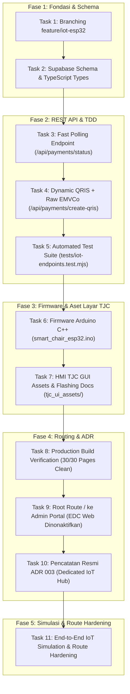

# 🚀 Sakura Zen - IoT Integration Progress Report & Handover Guide

> **Branch Repositori:** [`feature/iot-esp32`](https://github.com/SmartChairSakura/Sakura-Massage-Chair/tree/feature/iot-esp32)  
> **Target Perangkat:** ESP32 DevKit V1 (30 Pin) + Layar HMI TJC 4.3" (USART) + Relay Optocoupler (Active LOW)  
> **Target Kursi Pijat:** Tokuyo Massage Chair (Konektor Socket J3, Pulsa 200ms ON / 150ms OFF)  
> **Tanggal Update:** 21 Oktober 2026  
> **Status:** 🟢 **READY FOR HARDWARE FLASHING & BENCH TESTING**

---

## 1. 🔗 Informasi Repositori & Cara Akses Tim IoT

Branch **`feature/iot-esp32`** sudah dipush ke GitHub dan siap di-clone atau di-pull oleh tim IoT.

### A. Clone Repositori Baru (Jika belum punya repo):
```bash
git clone -b feature/iot-esp32 https://github.com/SmartChairSakura/Sakura-Massage-Chair.git
cd Sakura-Massage-Chair/smart-kursi-pijat-web
```

### B. Pull Update Terbaru (Jika sudah clone sebelumnya):
```bash
git fetch origin
git checkout feature/iot-esp32
git pull origin feature/iot-esp32
```

---

## 2. 📊 Rekap Progress Task Breakdown (100% Completed)

Seluruh 11 task fondasi software, API, firmware, aset GUI layar, dan pengujian simulasi telah rampung dikerjakan dengan hasil hijau tanpa mengganggu branch `main`:



### Rincian Pencapaian per Task:

| Task | Item Pekerjaan | File Terkait | Hasil & Verifikasi |
| :---: | :--- | :--- | :--- |
| **Task 1** | Isolasi Branch Git `feature/iot-esp32` | Git branch | 🟢 Branch aktif terisolasi, branch `main` 100% aman. |
| **Task 2** | Skema Supabase & Type `ClientDeviceType` | `src/types/index.ts` | 🟢 Mendukung `IOT_KIOSK`, telemetri `rssi`, `ip_address`, dan status perangkat. |
| **Task 3** | Fast Status Polling `< 250ms` | `src/app/api/payments/status/route.ts` | 🟢 Anti-cache header, payload `< 150B`, latensi rata-rata ~154ms. |
| **Task 4** | Dynamic QRIS + EMVCo String | `src/app/api/payments/create-qris/route.ts` | 🟢 Menghasilkan raw string `000201010212...` untuk komponen `qr0` TJC. |
| **Task 5** | Automated Test Suite (51 Tests) | `tests/iot-endpoints.test.mjs` | 🟢 51/51 automated tests lolos 100% (`npm test`). |
| **Task 6** | Firmware Arduino C++ ESP32 | `smart_chair_esp32/smart_chair_esp32.ino` | 🟢 FreeRTOS dual-task, pulse generator, fallback Supabase REST, command `BAYAR`. |
| **Task 7** | Aset HMI TJC 4.3" & TFT Binary | `tjc_ui_assets/` | 🟢 File `Sakura_TJC.HMI`, font `f_timer.zi`, binary `.tft`, panduan MicroSD. |
| **Task 8** | Verifikasi Build Next.js 14 | Workspace Next.js | 🟢 30/30 halaman terkompilasi optimal tanpa TypeScript / lint error. |
| **Task 9** | Routing Root `/` ke Dashboard Admin | `src/app/page.tsx` | 🟢 Halaman setup EDC Android dinonaktifkan, user langsung diarahkan ke `/admin/dashboard`. |
| **Task 10** | Architecture Decision Record (ADR 003) | `docs/adr/003-dedicated-iot-controller-hub-esp32-tjc.md` | 🟢 Dokumentasi arsitektur pergeseran dari Android Kiosk ke Dedicated Microcontroller. |
| **Task 11** | End-to-End IoT Simulation & Route Hardening | `scripts/simulate-iot-flow.mjs` | 🟢 Seluruh 9 tahap siklus IoT diverifikasi hijau via simulasi terminal. |

---

## 3. 📦 Panduan Eksekusi untuk Tim IoT (Handover Checklist)

Tim IoT dapat langsung menggunakan file dan aset yang ada di branch ini untuk memulai perakitan dan uji coba alat fisik:

### A. Lokasi File Utama:
1. **Source Code Firmware ESP32:**
   - Path: [`smart_chair_esp32/smart_chair_esp32.ino`](file:///home/rifpamks/Documents/Smart%20Kursi%20Pijat/smart-kursi-pijat-web/smart_chair_esp32/smart_chair_esp32.ino)
2. **Aset Layar TJC 4.3" (USART HMI):**
   - Path: [`tjc_ui_assets/`](file:///home/rifpamks/Documents/Smart%20Kursi%20Pijat/smart-kursi-pijat-web/tjc_ui_assets/)
   - File TFT Siap Flash: `tjc_ui_assets/output/sakura_zen_4_3.tft` (atau compile via USART HMI Editor menggunakan `Sakura_TJC.HMI`).
3. **Simulasi Interaktif UI Layar (Browser):**
   - Path: [`docs/hardware/tjc_sakura_simulator.html`](file:///home/rifpamks/Documents/Smart%20Kursi%20Pijat/smart-kursi-pijat-web/docs/hardware/tjc_sakura_simulator.html)

---

### B. Pinout & Skema Pengkabelan Hardware (Wiring Guide):

| Modul / Komponen | Pin Modul | Sambungkan ke Pin ESP32 | Keterangan |
|---|---|---|---|
| **Layar TJC HMI 4.3"** | `5V` | `VIN` (atau adaptor 5V 2A terpisah) | Rekomendasi supply daya minimal 1A-2A |
| | `GND` | `GND` | Common Ground wajib terhubung |
| | `TXD` | `GPIO 16 (RX2)` | Serial komunikasi baudrate 9600 bps |
| | `RXD` | `GPIO 17 (TX2)` | Serial komunikasi baudrate 9600 bps |
| **Relay Optocoupler** | `VCC` | `VIN (5V)` | Tegangan koil relay |
| | `GND` | `GND` | Common Ground |
| | `IN` | `GPIO 23` | Active LOW (Pulsa 200ms ON / 150ms OFF) |
| **Output Relay ke Tokuyo** | `COM & NO` | **Socket J3 Pin 1 & Pin 2** | Mensimulasikan pulsa koin / sakelar manual |

---

### C. Konfigurasi Firmware Sebelum Flashing:
Buka [`smart_chair_esp32.ino`](file:///home/rifpamks/Documents/Smart%20Kursi%20Pijat/smart-kursi-pijat-web/smart_chair_esp32/smart_chair_esp32.ino) dan sesuaikan baris berikut:

```cpp
// 1. Kredensial WiFi Lokasi / Hotspot HP Tim IoT
const char* WIFI_SSID     = "NAMA_WIFI_ANDA";
const char* WIFI_PASSWORD = "PASSWORD_WIFI";

// 2. Chair Code (Harus match dengan data di Database / Web Backoffice)
const char* CHAIR_ID      = "SAKURA-GI-01"; 

// 3. Backend Cloud URL (Gunakan domain Vercel / server testing)
const char* BASE_API_URL  = "https://sakura-massage-chair-git-feature-iot-esp32-sakura-26a0.vercel.app";
```

---

### D. Fitur Uji Coba Cepat Tanpa Uang Asli (Debug Command Tim IoT):

Tim IoT **tidak perlu mengeluarkan uang pribadi** untuk scan QRIS saat uji coba hardware di meja lab/bengkel. 

1. Colok ESP32 ke laptop dengan kabel USB.
2. Buka **Serial Monitor Arduino** pada baudrate `115200`.
3. Sentuh salah satu paket di Layar TJC (misal P1: 4 Menit / 5 Pulsa). QRIS akan muncul di layar.
4. Di Serial Monitor Arduino, ketik perintah:
   ```text
   BAYAR
   ```
   kemudian tekan **Enter**.
5. **Respon Sistem:**
   - ESP32 langsung menganggap pembayaran lunas.
   - Layar TJC otomatis beralih ke halaman **Timer Countdown (Page 2)**.
   - Relay pada GPIO 23 langsung berdetik 5 kali (200ms menyala, 150ms mati) memicu kursi Tokuyo jalan!

---

## 4. 📞 Rencana Langkah Selanjutnya (Next Steps)
1. **Handover ke Tim IoT:** Berikan link repositori branch `feature/iot-esp32` dan file dokumen ini kepada tim IoT.
2. **Bench Testing Hardware Fisik:** Tim IoT memvalidasi perakitan box controller fisik, relay, dan layar TJC menggunakan command `BAYAR`.
3. **Task 12 (Opsional):** Penyusunan checklist SOP instalasi fisik kursi di lokasi mal (Tokuyo Socket J3).
4. **Task 13 (Opsional):** Penambahan visualisasi kekuatan sinyal WiFi (`RSSI`) di dashboard kursi Backoffice.
