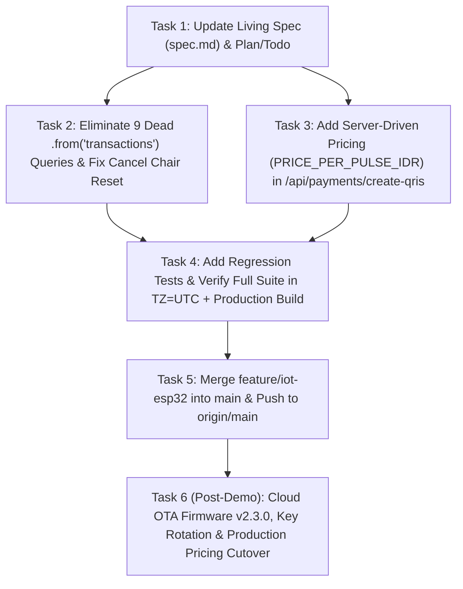

# Implementation Plan: IoT Branch Release to `main`, Dead-Code Elimination & Post-Demo Hardening

## 1. Overview
Menindaklanjuti selesainya *stress test*, audit keamanan (`VULN-01`–`VULN-10`), perbaikan RBAC `MANAGEMENT`, perbaikan *dual-axis section scrollbars*, dan sinkronisasi timezone WIB (`UTC+7`) di server `TZ=UTC`, rencana ini mengatur:
1. **Fase A (Sekarang — Pre-Demo Release ke `main`):**
   - Menghapus 9 query mati (`.from('transactions')`) di 7 endpoint API yang masih menembak tabel legacy `public.transactions` (`ERROR 42P01`), sekaligus memperbaiki reset status kursi ke `ONLINE` pada endpoint pembatalan sesi (`/api/transactions/[id]/cancel`).
   - Menambahkan dukungan **Server-Driven Pricing (`PRICE_PER_PULSE_IDR`)** pada `/api/payments/create-qris` agar peralihan harga demo (`Rp 5–40`) ke harga produksi (`Rp 5.000–40.000`) cukup dilakukan lewat environment variable Vercel tanpa perlu *flash* ulang ESP32.
   - Melakukan merge `feature/iot-esp32` ke `main` dan push ke `origin/main` agar domain produksi `https://sakura-massage-chair.vercel.app` (yang tertanam di `smart_chair_esp32_v2.ino:L24`) sinkron 100%.
2. **Fase B (Pasca-Demo Client — Production Cutover):**
   - Rilis Firmware ESP32 `v2.3.0` via Cloud OTA (mengganti `SUPABASE_KEY` ke `anon` key untuk polling *read-only* 1.2 detik, mengarahkan laporan status OTA & ACK ke endpoint Vercel dengan header `x-device-key`).
   - Rotasi `SUPABASE_SERVICE_ROLE_KEY` di Supabase Dashboard, aktifkan `IOT_DEVICE_SECRET`, `CRON_SECRET`, `JWT_SECRET`, dan set `PRICE_PER_PULSE_IDR=1000` di Vercel.

---

## 2. Dependency Graph

---

## 3. Risks & Mitigations

| Risk | Impact | Mitigation |
|---|---|---|
| Merotasi `SUPABASE_SERVICE_ROLE_KEY` sebelum demo | ESP32 `v2.2.0-ota` gagal polling bayar (`401`) | Jangan rotasi `service_role` key sebelum demo; lakukan OTA ke `v2.3.0` terlebih dahulu pasca-demo. |
| Mengaktifkan `IOT_DEVICE_SECRET` sebelum OTA `v2.3.0` | Heartbeat & ACK dari `v2.2.0-ota` ditolak `401` | Pertahankan `verifyOptionalSecret` dalam *graceful mode* (env `IOT_DEVICE_SECRET` dikosongkan selama demo). |
| Mengubah harga ke `Rp 5.000–40.000` saat demo | Penguji harus membayar Rp 5.000–40.000 per scan | Default `PRICE_PER_PULSE_IDR=1` selama demo; naikkan ke `1000` di Vercel saat cutover produksi. |
| Query ke tabel legacy `public.transactions` yang sudah dihapus | Menambah latensi 1 roundtrip gagal per request | Hapus seluruh `.from('transactions')` dari 7 route API dan gunakan `public.chair_slips` sebagai *single source of truth*. |
