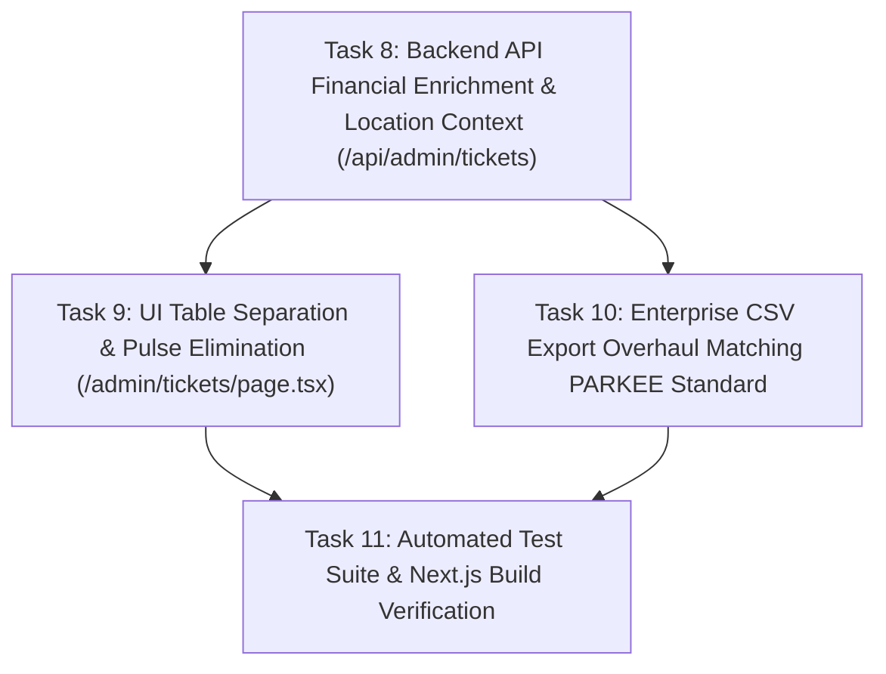

# Implementation Plan: Ticket Management Financial Breakdown & Enterprise CSV Export Overhaul

## Overview
Overhaul the Ticket Management page (`/admin/tickets`), Backend API (`/api/admin/tickets`), and CSV Export mechanism based on PARKEE settlement reference standards (`Ticket_25102026-25102026_DONE.csv`) and user requirements. This overhaul separates the mashed "Amount & Duration" table column into distinct financial columns (`Amount (Gross)`, `Net Payout`, `MDR`, `Platform Fee`, `Duration`), removes internal hardware pulse counts from client-facing views for visual cleanliness, enriches backend ticket payloads with location context and deterministically computed settlement splits, and expands CSV exports to 20 comprehensive enterprise audit columns.

---

## Architecture & Design Decisions

### 1. Financial Breakdown Schema & Logic
- **Financial Split Rules:**
  - **Paid / Completed / In-Process Sessions (`done`, `paid`, `completed`, `session_inprocess`):**
    - `Gross Sales (IDR)` = `amount`
    - `MDR Fee (IDR)` = `Math.round(Gross Sales * 0.007)` (0.7% QRIS MDR)
    - `Platform Fee (IDR)` = `Math.round(Gross Sales * 0.05)` (5% Dev Share)
    - `Net Payout (IDR)` = `Gross Sales - MDR Fee - Platform Fee` (94.3% Net Partner Payout)
  - **Unpaid / Pending / Expired / Cancelled Sessions (`pending`, `expired`, `cancelled`, `failed`):**
    - `Gross Sales (IDR)` = `amount` (nominal tagihan awal)
    - `MDR Fee (IDR)` = `0`
    - `Platform Fee (IDR)` = `0`
    - `Net Payout (IDR)` = `0`
- **Database Priority & PostgREST Enrichment:**
  - If a ticket already has a settlement record in `chair_slip_payments`, prioritize the exact database values (`amount`, `mdr_fee`, `dev_share`, `owner_net`, `pg_ref_number`, `payment_status`).
  - If a payment record is absent (historical/reconciled data), use the deterministic fallback calculation above.

### 2. UI Table Structure Overhaul (`/admin/tickets`)
- **Discrete Columns (Separated for Financial Clarity):**
  1. `Slip Number` (`font-mono text-xs font-semibold text-[#795465]`)
  2. `Date & Time` (Formatted WIB with 24h clock)
  3. `Location & Chair` (Location name in bold + Site code / Chair code in monospace)
  4. `Customer` (`customer_phone` or `GUEST`)
  5. `Amount` (Gross Sales: `font-semibold text-sm text-[#1B1C1C] tabular-nums`)
  6. `Net Payout` (Net Partner Share: `font-semibold text-sm text-[#0F6E56] tabular-nums` when paid, or `-` / `Rp 0` when unpaid)
  7. `MDR` (0.7%: `text-xs text-gray-500 tabular-nums`)
  8. `Platform Fee` (5%: `text-xs text-gray-500 tabular-nums`)
  9. `Duration` (Clean format: `8 mins` — **Zero pulse counts displayed**)
  10. `Payment Method` (`QRIS` + icon)
  11. `Status` (Semantic badge)
- **Zero Pulse Display:**
  - In response to user instruction: *"untuk jumlah pulse tidak usah di tampilkan agar lebih clean ke client"*, the text `({pulse_count} pulses)` is completely eliminated from the client-facing UI table.

### 3. Enterprise CSV Export Matching PARKEE Reference
- **20 Structured Settlement Columns:**
  ```csv
  Location,Location Code,Chair Code,Created From,Slip Number,Date & Time (WIB),Session Start (WIB),Session End (WIB),Duration (Mins),Customer,Payment Method,Payment Provider,Payment Status,PG Ref Number,MDR Paid By,Gross Sales (IDR),MDR Fee (IDR),Platform Fee (IDR),Net Payout (IDR),Ticket Status
  ```
- **Integrity & Compatibility:**
  - Byte Order Mark (`\uFEFF`) prefixed for seamless rendering in Excel/Sheets.
  - All textual values wrapped in escaped double quotes (`""`).
  - Numeric columns formatted as raw integer/float without thousands separators for direct formula calculation in spreadsheet software.
  - File naming suffix: `sakura_tickets_all_time.csv` or `sakura_tickets_<start>_to_<end>.csv`.

---

## Dependency Graph



---

## Task Breakdown Summary

### Phase 1: Backend API & Data Contracts
- [ ] **Task 8:** Enrich `/api/admin/tickets/route.ts` with financial breakdown (`gross_sales`, `mdr_fee`, `platform_fee`, `net_payout`, `pg_ref_number`, `payment_status`) and location metadata (`location_name`, `location_code`).

### Phase 2: Frontend Table & CSV Export Overhaul
- [ ] **Task 9:** Separate the UI table in `/admin/tickets/page.tsx` into individual financial columns (`Amount`, `Net Payout`, `MDR`, `Platform Fee`, `Duration`) and strip out pulse counts.
- [ ] **Task 10:** Update `handleExportCSV` to export 20 enterprise settlement columns matching PARKEE reference standards.

### Phase 3: Automated Verification
- [ ] **Task 11:** Write test suite `tests/tickets-financial-breakdown.test.mjs`, run all 100+ tests, and verify Next.js production build.
