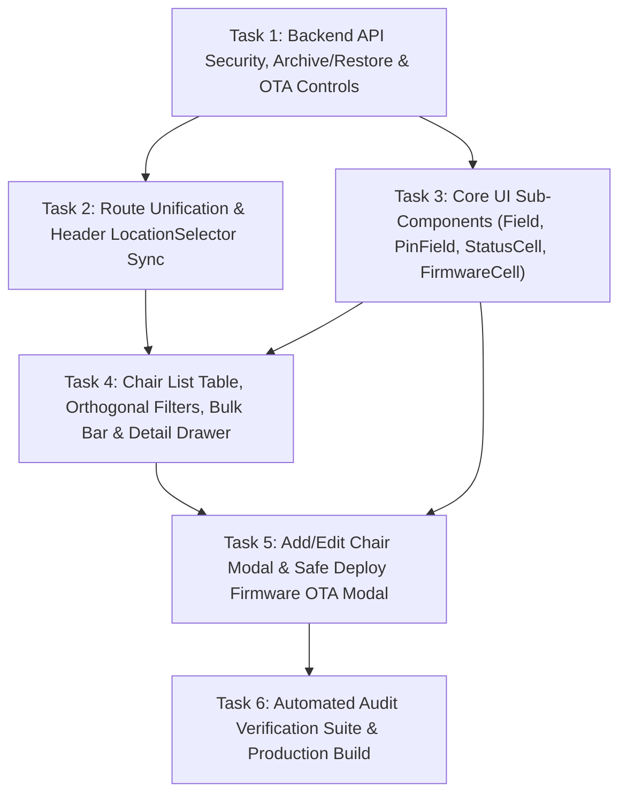

# Implementation Plan: Chair List, Edit Chair, & Firmware OTA UI/UX Overhaul

## Overview
Comprehensive security, UX, accessibility (WCAG 2.2 AA), typography, and interaction overhaul of the Chair Fleet Management surface (`/admin/chairs`, `/admin/locations/[locationId]/chairs`, Add/Edit Chair Modal, Chair Detail Drawer, and Deploy Firmware OTA Modal) based on `CHAIR_LIST_UIUX_AUDIT.md`. This plan eliminates plaintext Terminal PIN leakage, prevents accidental fleet-wide OTA broadcasts via staged canary rollouts and SHA-256 binary verification, unifies the duplicate chair list routes into a single synchronized view, enforces WCAG 2.2 AA contrast tokens (`--warn`, `--border-field`, `--text-muted`), standardizes typography (`Plus Jakarta Sans` 400/500/600 + `JetBrains Mono` for identifiers), and introduces reversible archive/OTA/branch-transfer workflows.

---

## Architecture & Design Decisions

### 1. Security & Safety First (P0)
- **Terminal PIN Protection (Section 7.1 & 12.1):**
  - `GET /api/admin/chairs` no longer exposes raw `pin` in bulk list responses. Instead, it returns `pin_masked: '••••••'` and `has_default_pin: boolean` (`true` if PIN is still `'123456'`).
  - Explicit PIN reveal requires an authenticated action (`POST /api/admin/chairs` with `action: 'REVEAL_PIN'`), which records an audit log entry (`admin email, chair_code, timestamp`) and displays the PIN temporarily in the Chair Detail panel or row with a copy button.
  - New chairs generate a random 6-digit numeric PIN (`generateRandomPin()`, excluding weak defaults like `123456` or `000000`) instead of pre-filling `123456`. The label `TERMINAL PIN (DEFAULT: 123456):` is replaced with concise `Terminal PIN` + helper `6-digit numeric code`.
  - `<PinField>` uses `type={show ? 'text' : 'password'}`, `inputMode="numeric"`, `maxLength={6}`, `pattern="\d{6}"`, digit-only sanitization, and an accessible `<Eye />` / `<EyeOff />` toggle button (`aria-pressed={show}`).
- **Safe Firmware OTA Deployment (Section 7.2 & 12.4):**
  - Default OTA target is `'SELECTED'` (when table checkboxes are selected) or requires explicit selection—never defaulting to `'ALL'` (`All Active Chairs`).
  - **Rollout Strategy:** Supports `canary` (`1 chair first` — default), `staged` (`10% of target`), and `all` (`All target chairs`).
  - **Impact Summary & Typed Confirmation Gate:** Displays affected chair count, branch count, and current version range. If targeting `'ALL'` or `> 5` chairs, requires typing `DEPLOY` into a confirmation field before enabling submission.
  - **SemVer & Version Guard:** Validates `/^\d+\.\d+\.\d+$/` and checks that the target version is strictly higher (`compareSemver > 0`) than the minimum installed version among targeted chairs.
  - **Accessible `.bin` Dropzone & Client/Server Verification:** Uses a keyboard-focusable `<input type="file" accept=".bin">` + `<label>` wrapper, enforces a `1.5 MB` (`1,572,864` bytes) ESP32 partition limit, computes the client-side **SHA-256** checksum via Web Crypto API, and shows filename, KB size, SHA-256 digest, and a `"Replace file"` button without closing the modal.
  - **Cancel Pending OTA & Rollback:** `PATCH /api/admin/chairs` supports `action: 'CANCEL_OTA'` (when `ota_status === 'PENDING'`) and `action: 'ROLLBACK_OTA'` (restoring `previous_firmware_version`).

### 2. Route Unification & Navigation Sync (P0)
- **Single Chair List Route (Section 7.3 & 12.5):**
  - `/admin/locations/[locationId]/chairs/page.tsx` is converted to a server/client redirect to `/admin/chairs?location=${params.locationId}`.
  - `/admin/locations/page.tsx` Fleet Size badge links directly to `/admin/chairs?location=${loc.id}`.
  - `LocationSelector.tsx` and `/admin/chairs/page.tsx` read and synchronize both `location` and `location_id` URL query parameters as a single source of truth.
- **Orthogonal Table Filters (Section 7.4):**
  - Removes the redundant Location dropdown from the table toolbar (keeping the global `LocationSelector` in `AdminHeader`).
  - Replaces it with two dedicated `AppSelect` filters: **Status** (`All Statuses`, `Online`, `In use`, `Offline`, `Updating`, `Error`) and **Firmware** (`All Firmware`, `Up to date`, `OTA Pending`, `Failed`), plus an **Active / Archived** view segmented pill.

### 3. Palette, Contrast, Typography & Icon Discipline (P1 & P2)
- **No Off-Palette `#1B1C1C` Black Buttons (Section 4):**
  - Header `"Deploy firmware"` button uses secondary surface tokens (`bg-white border border-(--border-field) text-(--text) hover:bg-(--bg-subtle)`).
  - Primary `"Add Chair"` button and modal submit buttons (`"Save Changes"`, `"Deploy 2.2.0 to N chairs"`) use `bg-(--brand) hover:bg-(--brand-hover) text-white`.
- **WCAG 2.2 AA Contrast Compliance (Section 3):**
  - Amber badges (`Waiting standby` / `OTA Pending` / `Default PIN`): `bg-(--warn-bg)` (`#FFF3D6`) + `text-(--warn)` (`#8A5A00`, 6.18:1).
  - Disabled Chair Code field: `bg-(--bg-subtle) text-(--text-muted) border-(--border-field)` (5.4:1) + `<Lock />` icon + helper `"Linked to physical hardware and cannot be changed."`
  - Form inputs & textareas: `bg-white border border-(--border-field)` (3.57:1 boundary contrast) with `placeholder:text-(--text-placeholder)` (4.83:1).
- **Typography & Label Discipline (Section 5 & 9):**
  - Zero `font-extrabold`. Page title `24px/600`, table headers `12px/600` muted, table cells `14px/400` (`Chair Code` `500`), modal labels `13px/500` sentence case without colons via shared `<Field>` component.
  - `JetBrains Mono` (`font-mono tabular-nums text-[13px]`) strictly reserved for `Chair Code`, `Firmware Version`, `SHA-256`, and `Terminal PIN`.
- **Icon Discipline (Section 6):**
  - `<CloudUpload />` appears once (header `"Deploy firmware"` button; removed from modal title and modal submit button).
  - `<MapPin />` removed from table body rows (kept only in header `LocationSelector`).
  - `<Armchair />` removed from page `H1` and modal headers (kept in sidebar and empty state).
  - Single `<Plus />` icon in `"Add Chair"` (no `+ + Add Chair`).
  - Status badges use semantic colored dots (`size-1.5 rounded-full`) + text instead of `<CheckCircle2 />`.

### 4. Telemetry Table, Edit Modal & Reversible Interactions (P0, P1, P2)
- **5-State `StatusCell` + Relative Heartbeat (`Last seen`) (Section 7.5 & 12.2):**
  - Maps chair state to `Online`, `In use` (`BUSY`), `Offline`, `Updating` (`ota_status === 'DOWNLOADING'`), or `Error` (`MAINTENANCE` / `ota_status === 'FAILED'`).
  - Renders `<time dateTime={...} title={...}>Last seen {formatRelativeTime(last_heartbeat)}</time>` using `Intl.RelativeTimeFormat('en', { numeric: 'auto' })`.
- **Single-Line `FirmwareCell` (Section 12.3):**
  - Displays `2.1.0 → 2.2.0` + `Waiting standby` badge + `Cancel` button on a single row (`whitespace-nowrap`).
- **Natural Sorting, Bulk Selection, & Chair Detail Drawer:**
  - Natural alphanumeric sort (`SAKURA-LWGWB-04` before `-05`) with sortable column headers (`aria-sort`).
  - Left checkbox column + floating/inline bulk action bar (`Deploy firmware to N chairs`, `Move branch`).
  - Clicking a `Chair Code` (`text-(--brand)`) opens a **Chair Detail & Telemetry Modal/Drawer** displaying IP, RSSI signal, heartbeat timestamp, audited PIN reveal, and OTA controls.
- **Reversible Archive & Dirty Close Guard (Section 7.6 & 8):**
  - Row delete is replaced with **Archive chair** (`8-second Undo toast` in `aria-live="polite"` region + `Archived` filter view with `Restore`).
  - Edit Chair uses `AppSelect` for `Hardware Model`, validates unique unit alias per branch, cleans up `"Stagging IoT"` typo, warns on branch transfer (with post-save Undo toast), disables `"Save Changes"` until dirty, and prompts `"Discard unsaved changes?"` when closing a dirty modal.

---

## Dependency Graph

---

## Task Breakdown Summary

### Phase 1: Foundation & Security Contracts
- [ ] **Task 1:** Harden `/api/admin/chairs` (mask PIN on GET, add audited `REVEAL_PIN`, `CANCEL_OTA`, `ROLLBACK_OTA`, and archive restoration `deleted_at: null`) and `/api/admin/chairs/firmware/upload` (SemVer validation, 1.5 MB size limit, SHA-256 hash, canary/staged target support).
- [ ] **Task 2:** Unify `/admin/locations/[locationId]/chairs` via redirect to `/admin/chairs?location=<id>`, update `/admin/locations` fleet link, and synchronize `LocationSelector.tsx` + `AdminHeader.tsx` with `?location` / `?location_id`.

### Checkpoint 1: Foundation & Routing
- [ ] API routes compile and enforce PIN masking & OTA validation
- [ ] Navigating to `/admin/locations/[id]/chairs` redirects cleanly to `/admin/chairs?location=<id>` and syncs the header selector

### Phase 2: Core Components & Table Overhaul
- [ ] **Task 3:** Build `PinField`, `StatusCell` (5 states + `Intl.RelativeTimeFormat` last seen), `FirmwareCell` (single-line transition + Cancel/Rollback), and shared `Field` wrapper.
- [ ] **Task 4:** Overhaul `/admin/chairs/page.tsx` header row, orthogonal toolbar filters (`Status` & `Firmware` `AppSelect` + `Active/Archived` toggle), natural alphanumeric sorting (`aria-sort`), bulk selection bar, clickable `Chair Code` detail drawer, and 8-second Archive Undo toast.

### Checkpoint 2: Table & Telemetry UX
- [ ] Table renders all 5 device states, relative heartbeat, single-line firmware status, masked PIN, and 40x40px neutral action buttons

### Phase 3: Modals Overhaul & Automated Verification
- [ ] **Task 5:** Overhaul Add/Edit Chair modal (`AppSelect` hardware model, readable disabled Chair Code with `<Lock />`, random 6-digit PIN default, unique alias check, branch transfer warning, dirty close guard) and Deploy Firmware OTA modal (non-`ALL` default, Canary/Staged/All strategy, SemVer check, accessible `.bin` input with SHA-256 & Replace file, typed `DEPLOY` gate, specific CTA label).
- [ ] **Task 6:** Create `tests/chair-list-uiux.test.mjs` covering all 18 checklist items from Section 13 of `CHAIR_LIST_UIUX_AUDIT.md`, update `tests/dashboard-copywriting.test.mjs` if needed, and verify `node --test` + `npm run build`.

### Checkpoint 3: Complete
- [ ] All 18 audit items verified by automated tests (`tests/*.test.mjs`)
- [ ] Production build (`npm run build`) succeeds with zero errors

---

## Risks and Mitigations
| Risk | Impact | Mitigation |
|---|---|---|
| Existing copywriting test (`tests/dashboard-copywriting.test.mjs`) checks exact English headers (`Chair Code`, `Hardware Model`, `Unit Name`, `Branch Location`, `Terminal PIN`, `Add Chair`) | Med | Preserve these exact English table column headers and CTA text so both the audit dictionary and existing TDD tests pass seamlessly. |
| Web Crypto API (`crypto.subtle.digest`) availability in browser vs SSR | Low | Execute SHA-256 file hashing inside the client `onChange` handler (browser runtime) with a graceful fallback, and compute authoritative SHA-256 via Node `crypto.createHash('sha256')` on the server route. |
| URL query parameter mismatch (`location` vs `location_id`) across pages | Med | Support both `searchParams.get('location')` and `searchParams.get('location_id')` in `LocationSelector.tsx` and `/admin/chairs/page.tsx`. |
